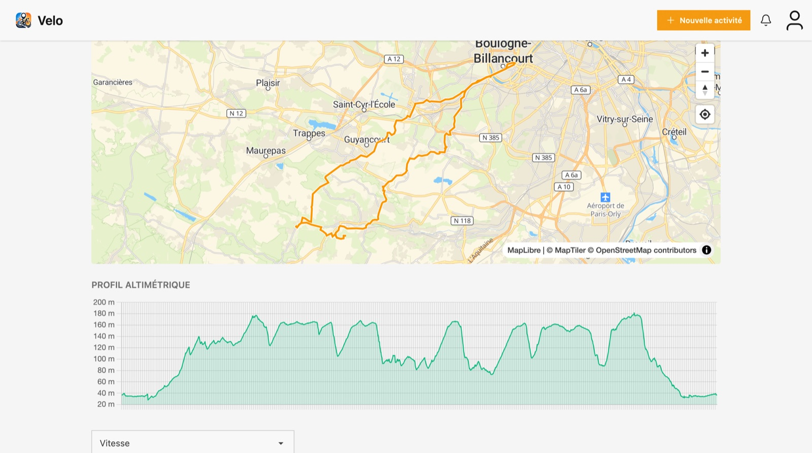
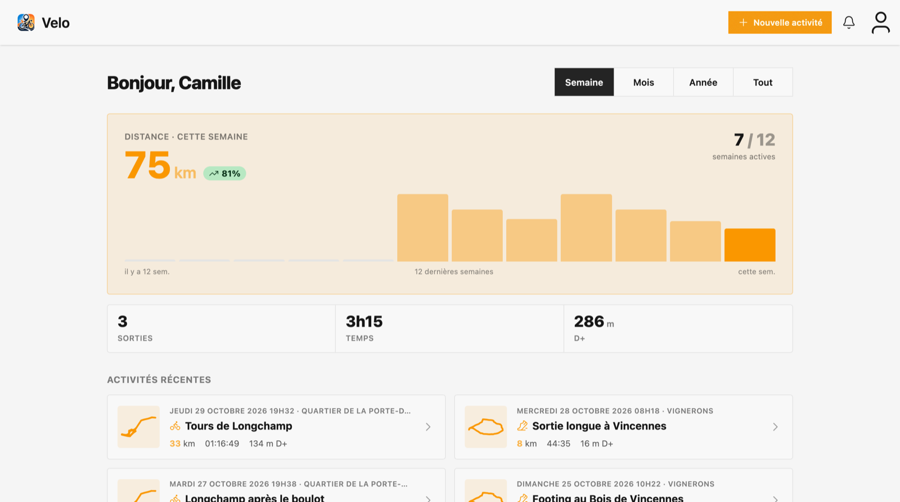
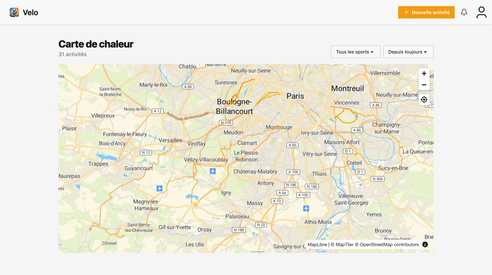
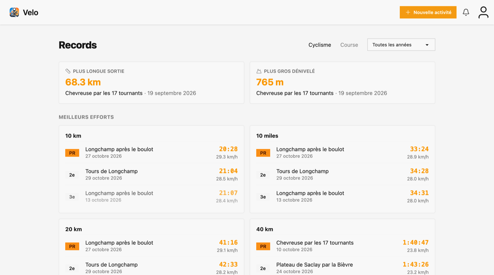
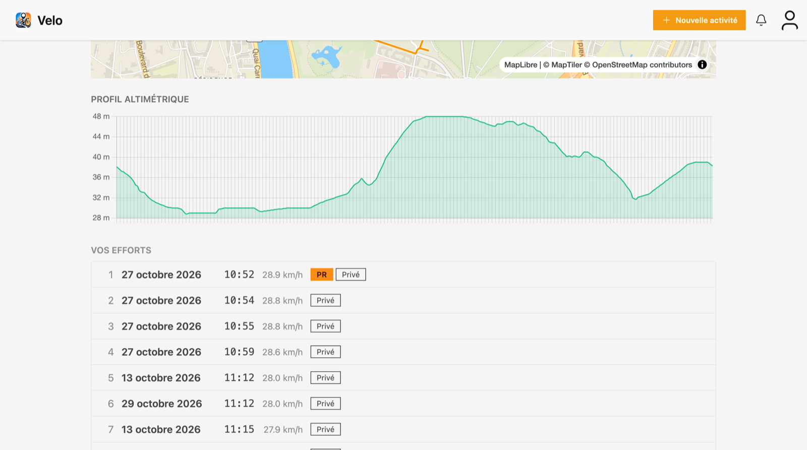
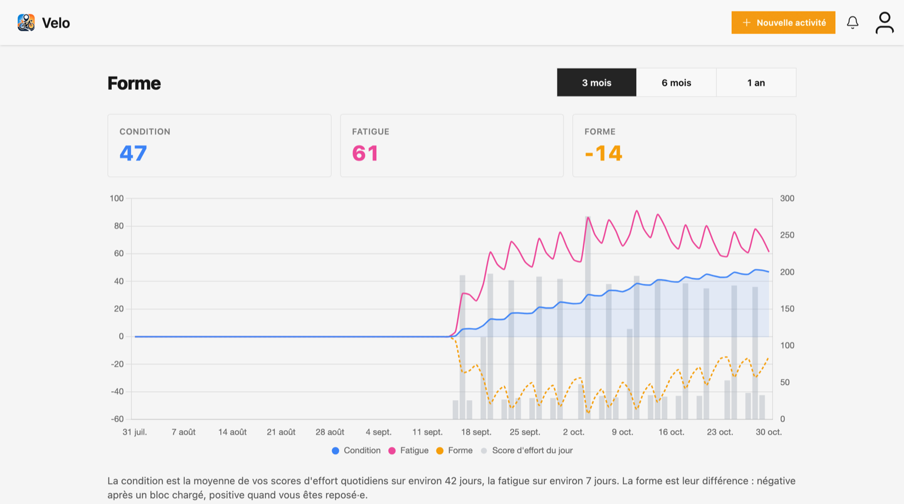
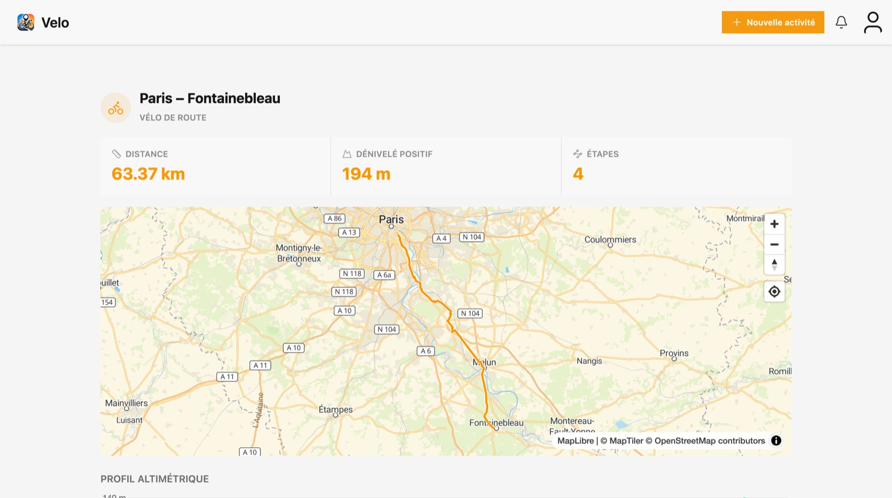
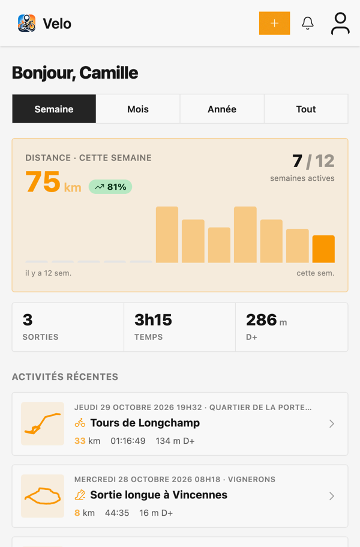
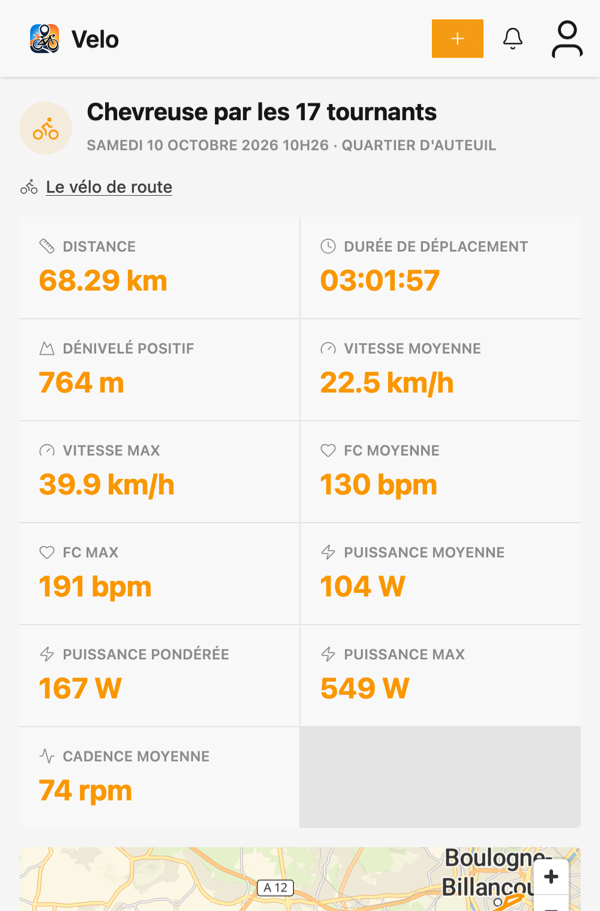
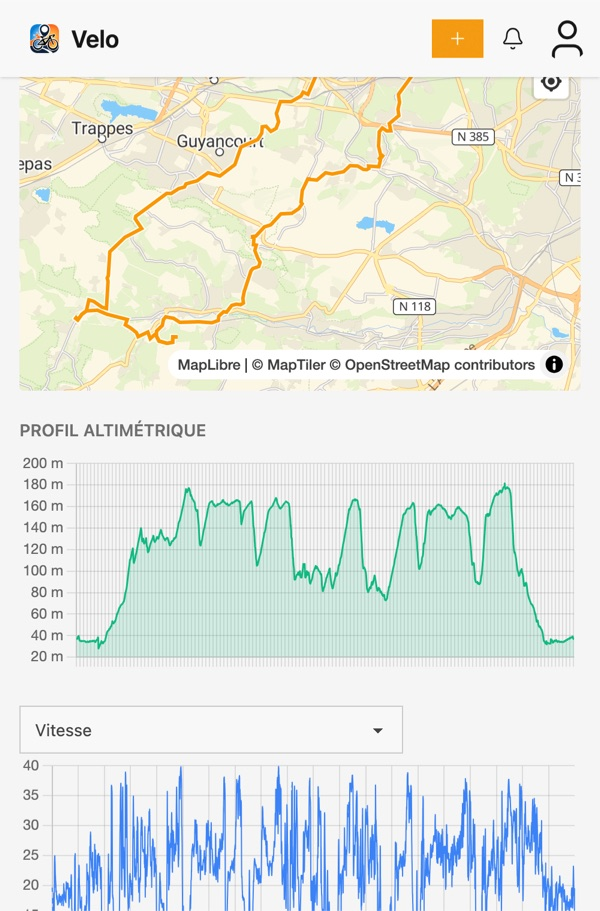

# Velo

Velo is a self-hosted cycling and running tracker: a personal alternative to Strava that keeps
your activities on your own server. The interface is in French.



## Features

- **Activities**: upload FIT or GPX files, or record rides and runs with the iOS and Android apps
  (GPS, laps, auto-pause, Bluetooth heart-rate straps). Each activity gets a map, speed /
  heart-rate / cadence / power charts and an effort score.
- **Imports**: bring your history over from a Strava export ZIP, or sync rides automatically from
  an iGPSport account.
- **Records**: best efforts over standard distances, a power curve, and segments you draw on an
  activity, with every effort on them ranked.
- **Fitness**: condition, fatigue and form from your daily effort scores, plus heart-rate and
  power zones for each activity.
- **Heatmap** of everywhere you've been, served as vector tiles.
- **Planned routes**: draw or import a route, then share it as a link or a GPX file.
- **Gear**: bikes, shoes and their components, with distance tracked per item.
- **Privacy**: hidden map zones around places like your home, and per-activity visibility with
  share links.

## Screenshots

| | |
|---|---|
|  |  |
| **Dashboard** | **Heatmap** |
|  |  |
| **Records** | **Segments** |
|  |  |
| **Fitness** | **Planned routes** |

On a phone (the same pages power the iOS and Android apps):

<p>
  
  
  
</p>

<sub>The rider, rides and numbers in these screenshots are made up.</sub>

## Stack

Rails 8.1, PostgreSQL + PostGIS, Hotwire (Turbo, Stimulus), Tailwind CSS with daisyUI, Importmap
(no Node build step), Solid Queue / Cache / Cable, MapLibre GL and Chart.js. FIT files are
decoded by `lib/ruby_fit`, a C extension around Garmin's FIT SDK. Deployed with Kamal.

The iOS and Android apps under `native/` are [Hotwire Native](https://native.hotwired.dev/)
shells around the web app, with native recording screens.

## Getting started

Requirements: Ruby (version in `.ruby-version`; `mise install` sets it up), Docker, and a
PostgreSQL client (`psql`) on your `PATH`.

```bash
git clone https://github.com/armandmgt/velo.git
cd velo
bundle install
(cd lib/ruby_fit && rake compile)   # the app won't boot without the FIT extension
docker compose up -d db              # PostgreSQL + PostGIS on port 5432
```

The encrypted credentials in the repo belong to the maintainer's deployment, so create your own:

```bash
rm config/credentials.yml.enc
bin/rails db:encryption:init         # prints the active_record_encryption keys
bin/rails credentials:edit           # paste them, plus maptiler_api_key: <your key>
```

Maps need a free [MapTiler](https://www.maptiler.com/) API key. Then:

```bash
bin/rails db:prepare db:seed         # dev user: test@example.com / dev
bin/dev                              # http://localhost:3000
```

## Tests

```bash
bin/rails test
bin/rails test:system                # Capybara + Selenium
bin/rubocop
bin/brakeman --no-pager
```

## Native apps

```bash
cd native/ios && mise run debug       # Xcode, project generated with xcodegen
cd native/android && mise run debug   # Android SDK
```

Debug builds talk to the dev server on your machine (`localhost:3000`, or `10.0.2.2:3000` from
the Android emulator). Maestro flows under `native/{ios,android}/maestro/` cover the main screens.

## Self-hosting

`config/deploy.yml` is the maintainer's Kamal setup: swap in your own server, domain and registry,
and give production its own credentials (`bin/rails credentials:edit --environment production`,
including an `smtp` block for password-reset emails).

## License

[MIT](LICENSE). The Garmin FIT SDK sources in `lib/ruby_fit/ext/ruby_fit/` are Garmin's, under
the [FIT Protocol License](https://developer.garmin.com/fit/download/).
